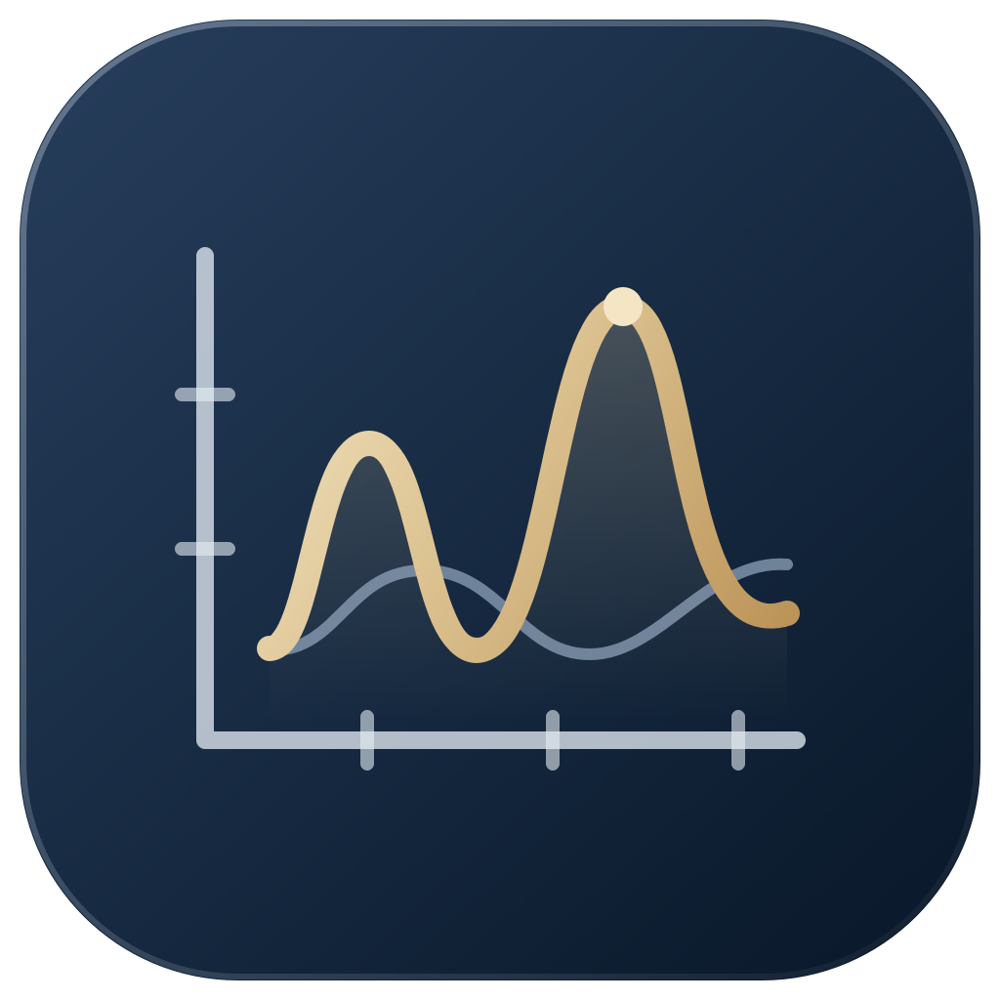

<p align="center"></p>

# 绘图器 1.0

面向 XPS / XRD 的 Windows 学术绘图工具。整理数据、预览图谱，再在 Origin 中生成可编辑的原生图页。

深墨蓝与香槟金谱峰图标，简约浅色界面。支持分别绘图、分层对比和曲线叠加。

## 下载与运行

本轮先公开源码，请按下方“源码运行与构建”运行。历史 v1.0 便携包暂存为发布草稿；完成打包依赖许可说明与复验后再公开附件。它不代表新发布的开源构建。

便携包的运行方式为完整解压后双击 `软件/绘图器.exe`，保留同目录的 `_internal` 和 `绘图器-MCP.exe`。便携版无需安装 Python，需要已安装 Origin。

## 主要功能

- XPS 表格：识别能量、实测、分峰、包络和背景列，保留缺失点及明确的单位。
- XRD 文本及 PDF# 参考卡：范围检查、可选归一化、同页对比和参考峰。
- 原生 Origin 轴标题、模板页尺寸、绘图区宽度和字体；曲线与工作表可以继续编辑。
- 样品分类、排序、改名、改色、勾选、数据预览及工作区保存和恢复。
- MCP 自动导入、绘图、审计、工作区管理和桌面预览，共 12 个业务工具。
- Origin 进程与工程校验；关闭绘图器会保留 Origin 会话。

XPS 分峰使用文件已有数据，软件不执行新的拟合。`.json` 工作区保存数据与选项，Origin 工程需要在 Origin 自行保存。

## MCP

打开绘图器，点击左下角“自动化接口”复制配置。将命令路径设置为本机 `绘图器-MCP.exe` 的绝对路径。
桌面软件已运行时，接口与它共用工作区；未运行时使用独立工作区。仅提供业务操作，不提供任意脚本执行。

## 源码运行与构建

Windows x64，Python 3.13：

```powershell
python -m pip install -r requirements.txt
python main.py
python -m pip install -r requirements-dev.txt
python tools/make_icon.py
python -m PyInstaller --noconfirm build.spec
```

完整 `dist/Plotter` 文件夹是便携软件。SVG 是图标源文件，PNG 与多尺寸 ICO 由构建工具生成。
图形界面和 MCP 共用 `studio/service.py` 的串行服务，Origin COM 只在一个线程中操作。

## 验证

```powershell
python -m pytest -q
python tests/validate_mcp.py
python tests/validate_packaged_ui.py
```

真实 Origin 集成测试使用本机样本路径，需要按测试电脑调整。测试会验证独立进程和空工程再绘图。
已在 Windows 10 x64 / Origin 10.100178 上验证；其他电脑与版本尚未实测。

本仓库的原创源码采用 MIT 许可。构建目录、私人数据与实验工作区不纳入源码提交。历史 v1.0 附件早于本次开源整理，源码与许可说明以默认分支为准。


## 关联项目与开源说明

[Origin Spectra MCP](https://github.com/g457337844-spec/origin-spectra-mcp) 是工具组的核心 MCP 服务；[Avantage MCP](https://github.com/g457337844-spec/avantage-mcp) 提供光谱处理和曲线导出。现有能力与跨工具一键绘图目标见 [docs/ecosystem.md](docs/ecosystem.md)。独立 Plotter 已能直接连接 Origin，不必再启动 Origin Spectra MCP。

[MIT 许可](LICENSE) · [第三方说明](NOTICE) · [贡献指南](CONTRIBUTING.md) · [安全说明](SECURITY.md)。Origin 商业软件不随项目提供。
